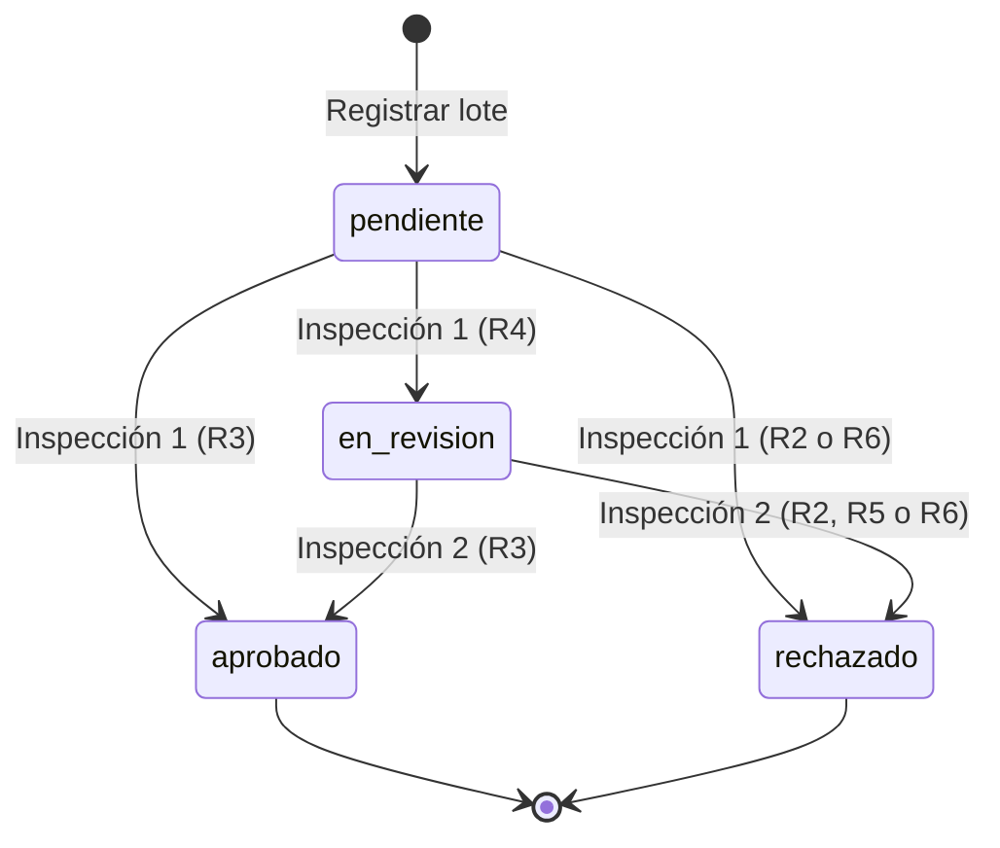

# Plan técnico · Control de Calidad por Lotes

**Autor:** Daniel Vergara · **Materia:** Lógica y Programación · **Programa:** Ingeniería Industrial
**Ubicación en el repositorio:** `doc/PLAN_CONTROL_CALIDAD.md`
**Documentos relacionados:** `doc/PROMPTS_CONTROL_CALIDAD.md` (prompts de ejecución), `proyecto/PLAN.md` (plan funcional entregado en clase).

---

## 0. Propósito y cómo usar este documento

Este documento es el **plan técnico** del sistema. El plan funcional (`PLAN.md`) dice *qué* decide el sistema; este dice *cómo se construye*: base de datos, reglas, API, pantallas y pruebas.

- Es la fuente de verdad para los prompts de `PROMPTS_CONTROL_CALIDAD.md`. Cada prompt cita secciones de este archivo por número. **No se renumeran las secciones.**
- Si el código y este plan se contradicen, prevalece el plan (y si el plan está mal, se corrige el plan primero).
- La numeración de las reglas funcionales **R1 a R8** (sección 5.1) es la misma del plan funcional.
- Los valores numéricos de las reglas (3 %, 5 %, 10 %, 20, 2, 30, 3, 200) viven en un solo lugar: `lib/config/calidad.ts` (sección 8.4).
- Convención de rutas: `app/`, `lib/`, `components/`, `scripts/`, `tests/` y `supabase/` se escriben desde la raíz del código. Si el proyecto usa `src/`, todo cuelga de `src/` (la decisión se registra en `doc/ESTADO_ACTUAL.md`).

**Glosario**

| Término | Significado |
|---|---|
| Lote | Tanda de piezas producidas, identificada por un código único. |
| Muestra | Subconjunto de piezas del lote que se revisa. |
| Pieza defectuosa | Pieza de la muestra fuera de tolerancia. |
| Pieza crítica | Pieza defectuosa con defecto de seguridad. Toda crítica también cuenta como defectuosa. |
| Muestra mínima | Piezas que como mínimo hay que revisar (regla R1). |
| Zona de revisión | Entre 3 % y 5 % de piezas defectuosas, ambos inclusive. |

---

## 1. Contexto y punto de partida

### 1.1 Qué se construye

Un sistema web para que una planta pequeña de piezas plásticas registre sus lotes, inspeccione una muestra de cada uno y obtenga una decisión consistente (aprobado, en revisión o rechazado) con la regla que se aplicó. Reemplaza la planilla en papel y la hoja de cálculo semanal.

### 1.2 Punto de partida

El proyecto parte de una base ya montada. **No se rehace.**

| Ya existe | Detalle |
|---|---|
| Aplicación Next.js (App Router) | Desplegada en Vercel con despliegue automático desde el repositorio. |
| Base de datos Postgres en Supabase | Se accede desde el servidor con el paquete `pg` y la variable `DATABASE_URL`. |
| Login funcionando | Un solo usuario, sin roles. No se reescribe. |

La variable `DATABASE_URL` debe existir en `.env.local` y en Vercel (Production, Preview y Development). Se usa la cadena de conexión *Transaction pooler* (puerto 6543).

### 1.3 Autenticación y sesión

- Cualquier usuario autenticado puede usar todo el sistema. No hay roles ni permisos distintos.
- El módulo **no modifica** el login. Solo lo consume a través de `lib/auth/sesionUsuario.ts`:
  - `obtenerUsuario()` devuelve `{ id, nombre, correo }` o `null`.
  - `exigirUsuario()` lanza `ErrorDeNegocio('NO_AUTORIZADO')` si no hay sesión.
- Después de iniciar sesión, el usuario llega a `/calidad` (único cambio sobre el login: el destino de la redirección).
- La protección se aplica en dos capas: el archivo de protección de rutas (`proxy.ts` en Next.js 16, `middleware.ts` en versiones anteriores) y `exigirUsuario()` como primera instrucción de cada ruta de `app/api/calidad/`.

---

## 2. Alcance

### 2.1 Problema que resuelve

1. Decisiones inconsistentes: el mismo porcentaje de defectos se aprueba o se rechaza según el inspector.
2. Sin trazabilidad: no se puede reconstruir qué muestra y qué resultado tuvo un lote.
3. Proveedores problemáticos sin detectar: no se cruzan lotes rechazados con proveedor.

### 2.2 Usuario

Una sola persona de calidad por planta. No hay administradores, supervisores ni clientes dentro del sistema.

### 2.3 Stack y decisiones técnicas

| Decisión | Elección | Por qué |
|---|---|---|
| Framework | Next.js (App Router) + TypeScript | Ya está montado y desplegado; el tipado ayuda a no mezclar campos al pasar datos entre capas. |
| Estilos | Tailwind CSS con componentes propios en `components/ui/` | Evita instalar una librería de componentes y mantiene el diseño bajo control. |
| Base de datos | Postgres de Supabase, acceso con `pg` y SQL con parámetros | El modelo es relacional (proveedores → lotes → inspecciones) y las restricciones de la base protegen las reglas aunque falle el código. |
| Validación | Zod, un solo archivo de esquemas | El mismo esquema valida en el navegador y en el servidor. |
| Pruebas | Vitest | Las reglas son funciones puras: se prueban con números, sin base de datos. |
| Reglas de negocio | Módulo `lib/reglas/` sin acceso a base de datos, red ni reloj | Cada regla del plan funcional queda en una función que se prueba sola. |
| Decisión de calidad | Aritmética entera | Ver sección 5.3. |
| Despliegue | Vercel | Ya configurado; cada `git push` despliega. |
| Login | El existente | No es parte del alcance del módulo. |

### 2.4 Funcionalidades

**Módulo mínimo** (resuelve el problema y se puede mostrar funcionando):

| # | Funcionalidad | Pantalla principal |
|---|---|---|
| F1 | Registrar un lote de producción | `/calidad/lotes/nuevo` |
| F2 | Registrar la inspección de una muestra | `/calidad/lotes/[codigo]/inspeccion` |
| F3 | Calcular el resultado del lote según las reglas | (se ejecuta al registrar la inspección) |
| F4 | Consultar el historial de lotes con filtros | `/calidad/lotes` |

Apoyos del módulo mínimo: bandeja de trabajo (`/calidad`), gestión de proveedores (`/calidad/proveedores`), detalle del lote y edición/eliminación de lotes sin inspecciones.

**Opcional** (solo si el módulo mínimo está terminado y aceptado):

| # | Funcionalidad |
|---|---|
| F5 | Alertar cuando un proveedor acumula lotes rechazados en los últimos 30 días (sección 16) |

### 2.5 Fuera de alcance

- Roles, varios usuarios o permisos distintos.
- Edición o eliminación de inspecciones (una inspección registrada es definitiva).
- Una tercera inspección de un lote.
- Indicadores, gráficas y reportes por periodo; exportación a PDF o Excel.
- Integración con sensores, cámaras o máquinas de inspección.
- Trazabilidad al lote de materia prima: solo se guarda el proveedor.
- Cambio automático de proveedor: el sistema solo avisa.
- Funcionamiento sin conexión.

---

## 3. Mapa de rutas y acceso

### 3.1 Páginas

| Ruta | Contenido | Acceso |
|---|---|---|
| (ruta de login existente) | Inicio de sesión | Público |
| `/calidad` | Bandeja de trabajo | Con sesión |
| `/calidad/lotes` | Historial con filtros | Con sesión |
| `/calidad/lotes/nuevo` | Registrar lote | Con sesión |
| `/calidad/lotes/[codigo]` | Detalle del lote | Con sesión |
| `/calidad/lotes/[codigo]/editar` | Editar lote (solo si no tiene inspecciones) | Con sesión |
| `/calidad/lotes/[codigo]/inspeccion` | Registrar inspección y ver resultado | Con sesión |
| `/calidad/proveedores` | Gestión de proveedores | Con sesión |

### 3.2 Protección

- Sin sesión, las páginas de `/calidad` redirigen al login.
- Sin sesión, las rutas de `/api/calidad` responden **401** con el formato de la sección 9.1.
- El matcher del archivo de protección incluye `/calidad/:path*` y `/api/calidad/:path*`, conservando lo que ya protegía.
- `app/calidad/layout.tsx` repite la comprobación (`obtenerUsuario()`) como segunda capa.

---

## 4. Estados del lote y acciones

### 4.1 Ciclo de vida



`aprobado` y `rechazado` son estados finales: el lote no admite más inspecciones.

### 4.2 Estados y etiquetas

| Estado (código) | Etiqueta en pantalla (`ETIQUETA_ESTADO`) | Tono (sección 11) |
|---|---|---|
| `pendiente` | Pendiente de inspección | `pendiente` |
| `en_revision` | En revisión | `revision` |
| `aprobado` | Aprobado | `aprobado` |
| `rechazado` | Rechazado | `rechazado` |

El estado nunca se comunica solo con color: siempre lleva texto.

### 4.3 Acciones permitidas (`accionesPermitidas(estado, totalInspecciones)`)

| Estado | Inspecciones | `INSPECCIONAR` | `EDITAR_LOTE` | `ELIMINAR_LOTE` | Siguiente inspección |
|---|---|---|---|---|---|
| `pendiente` | 0 | sí | sí | sí | 1 |
| `en_revision` | 1 | sí | no | no | 2 |
| `aprobado` | 1 o 2 | no | no | no | ninguna |
| `rechazado` | 1 o 2 | no | no | no | ninguna |

Un lote solo se edita o se elimina mientras está `pendiente` y no tiene inspecciones.

---

## 5. Reglas del sistema

### 5.1 Las ocho reglas

| # | Regla | Valores | Dónde se aplica |
|---|---|---|---|
| R1 | **Muestra mínima.** Se muestrea al menos el 10 % de la producción (redondeado hacia arriba), con un mínimo de 20 piezas. Si el lote tiene menos de 20 piezas, se muestrea el lote completo. | 10 %, 20 | `calcularMuestraMinima`, `validarInspeccion`, `ck_lotes_muestra` |
| R2 | **Defecto crítico.** Una o más piezas críticas rechazan el lote, sin importar el porcentaje. | 1 pieza | `decidirResultado` |
| R3 | **Aprobación.** Sin críticas y con porcentaje defectuoso **menor a 3 %**, el lote se aprueba. | 3 % | `decidirResultado` |
| R4 | **Zona de revisión.** Sin críticas y con porcentaje **entre 3 % y 5 % inclusive** en la primera inspección, el lote queda en revisión y requiere una segunda inspección con muestra nueva. | 3 %, 5 % | `decidirResultado` |
| R5 | **Segunda inspección.** Si la segunda inspección vuelve a caer entre 3 % y 5 %, el lote se rechaza. No existe una tercera inspección. | máx. 2 | `decidirResultado`, `ck_inspecciones_numero`, `ck_inspecciones_segunda` |
| R6 | **Rechazo por porcentaje.** Sin críticas y con porcentaje **mayor a 5 %**, el lote se rechaza. | 5 % | `decidirResultado` |
| R7 | **Proveedor en alerta** *(opcional)*. Un proveedor con 3 o más lotes rechazados en los últimos 30 días queda en alerta. | 3 lotes, 30 días | `evaluarAlertaProveedor` |
| R8 | **Validación de entradas.** Se rechaza la inspección si la muestra es menor al mínimo o mayor al lote, si las defectuosas superan la muestra, o si las críticas superan las defectuosas. Un lote cerrado no admite más inspecciones. | — | `validarInspeccion`, `validarLoteAdmiteInspeccion`, `ck_inspecciones_*` |

**Validaciones de datos del lote**

| Campo | Regla |
|---|---|
| Código | 2 a 30 caracteres; solo letras mayúsculas, números y guion; no empieza por guion. Se normaliza (recorte de espacios y mayúsculas) antes de buscar o guardar. Único. |
| Producto | 2 a 100 caracteres, sin contar espacios sobrantes. |
| Fecha de producción | Formato `YYYY-MM-DD`, fecha real, no posterior a hoy (hora de Bogotá). |
| Cantidad producida | Entero mayor a 0. |
| Proveedor | Debe existir y estar activo (al editar, el proveedor actual puede seguir aunque esté inactivo). |

**Orden de evaluación de la decisión** (`decidirResultado`):

1. Si hay una o más críticas → `rechazado`, **R2**.
2. Si el porcentaje es menor a 3 % → `aprobado`, **R3**.
3. Si el porcentaje es mayor a 5 % → `rechazado`, **R6**.
4. Queda el rango 3 % a 5 % inclusive: primera inspección → `en_revision`, **R4**; segunda inspección → `rechazado`, **R5**.

### 5.2 Casos límite

| Caso | Resultado | Por qué |
|---|---|---|
| Exactamente 3,00 % sin críticas (1.ª inspección) | En revisión, R4 | R3 exige estrictamente menos de 3 %. |
| Exactamente 5,00 % sin críticas (1.ª inspección) | En revisión, R4 | R6 exige estrictamente más de 5 %. |
| 3,00 % exacto en la 2.ª inspección | Rechazado, R5 | Sigue en la zona de revisión y no hay tercera inspección. |
| 1 pieza crítica de 100 (1,00 %) | Rechazado, R2 | R2 se evalúa antes que el porcentaje. |
| Lote de 195 piezas | Muestra mínima 20 | 10 % = 19,5, se redondea hacia arriba a 20. |
| Lote de 100 piezas | Muestra mínima 20 | 10 % = 10, por debajo del mínimo de 20. |
| Lote de 15 piezas | Muestra mínima 15 | Menos de 20 piezas: se muestrea el lote completo. |
| Muestra de 20 en un lote de 210 (mínimo 21) | Error `MUESTRA_INSUFICIENTE` | La muestra no llega al mínimo. |

### 5.3 Por qué se decide con enteros

Las decisiones de calidad se toman con aritmética entera, nunca con un porcentaje con decimales:

| Decisión | Fórmula entera | No se usa |
|---|---|---|
| Aprobado (R3) | `defectuosas * 100 < UMBRAL_APROBACION_PCT * muestreadas` | `(defectuosas / muestreadas) * 100 < 3` |
| Hasta 5 % inclusive | `defectuosas * 100 <= UMBRAL_REVISION_PCT * muestreadas` | `(defectuosas / muestreadas) * 100 <= 5` |
| Muestra mínima | `Math.ceil((cantidad * PORCENTAJE_MUESTRA) / 100)` | `Math.ceil(cantidad * 0.1)` |

**Ejemplo.** Con 3 defectuosas de 100 muestreadas: `3 * 100 = 300` y `3 * 100 = 300`, así que `300 < 300` es falso (no aprueba) y `300 <= 500` es verdadero (zona de revisión). Todo son enteros y la comparación es exacta.

**Por qué.** Los números decimales de JavaScript son binarios y no representan exactamente valores como 0,1 (por ejemplo, `0.1 + 0.2` da `0.30000000000000004`). En las pruebas hechas para este plan, los rangos prácticos (hasta 5.000 muestreadas y 2.000.000 piezas por lote) dieron el mismo resultado con decimales y con enteros; aun así, con enteros la decisión es exacta por construcción y no hay que demostrar que ningún caso futuro falla.

**Porcentaje para mostrar.** `calcularPorcentaje` redondea a dos decimales usando solo enteros: `Math.round((defectuosas * 10000) / muestreadas) / 100`. Coincide con el redondeo de la base de datos (columna `porcentaje_defectuoso`): por ejemplo 57 de 800 es 7,125, que ambos muestran como 7,13. Un cálculo con `(d / m) * 100` redondeado daría 7,12. **El porcentaje con decimales solo se muestra; nunca decide.**

### 5.4 Textos de explicación

`decidirResultado` devuelve una explicación en español. `{p}` es el porcentaje con dos decimales y coma (por ejemplo `3,00`). Los umbrales se interpolan desde `lib/config/calidad.ts`; no se escriben a mano en el código.

| Regla | Texto |
|---|---|
| R2 | `Hay {n} pieza crítica en la muestra.` / `Hay {n} piezas críticas en la muestra.` + ` Un defecto crítico rechaza el lote sin importar el porcentaje ({p} %).` |
| R3 | `El {p} % de piezas defectuosas es menor al 3 %: el lote se aprueba.` |
| R4 | `El {p} % de piezas defectuosas está entre 3 % y 5 % (ambos inclusive): el lote queda en revisión y requiere una segunda inspección con una muestra nueva.` |
| R5 | `En la segunda inspección el {p} % de piezas defectuosas sigue entre 3 % y 5 %: el lote se rechaza. No se permite una tercera inspección.` |
| R6 | `El {p} % de piezas defectuosas supera el 5 %: el lote se rechaza.` |

Etiquetas de regla (`DESCRIPCION_REGLA`): `Regla 2 · Defecto crítico`, `Regla 3 · Aprobación`, `Regla 4 · Zona de revisión`, `Regla 5 · Segunda inspección`, `Regla 6 · Rechazo por porcentaje`.

---

## 6. Registro de inspección: flujo transaccional

### 6.1 Principios

- Una inspección y el cambio de estado del lote ocurren **en una sola transacción**: o se guardan ambos o ninguno.
- El lote se bloquea (`SELECT ... FOR UPDATE`) para que dos inspecciones simultáneas no se pisen.
- Las inspecciones no se editan ni se eliminan.

### 6.2 `registrarInspeccion(codigo, datos)`

Dentro de `conTransaccion`:

1. **`bloquearLotePorCodigo`**: `SELECT ... FROM lotes WHERE codigo = $1 FOR UPDATE`. Si no existe → `LOTE_NO_ENCONTRADO`.
2. **`validarLoteAdmiteInspeccion(estado)`**: devuelve el número de inspección (`pendiente` → 1, `en_revision` → 2) o lanza `LOTE_CERRADO`.
3. **`validarInspeccion`** con la cantidad y la muestra mínima del lote (R1 y R8).
4. **`decidirResultado`** con el número de inspección y las tres cantidades.
5. **`insertarInspeccion`**: inserta con `fecha_inspeccion = hoyBogota()`, el `resultado` y la `regla`; `RETURNING porcentaje_defectuoso`.
6. **`actualizarDecisionLote`**: actualiza `estado`; `fecha_decision` queda en `hoyBogota()` si el estado es `aprobado` o `rechazado`, y en `null` si es `en_revision`; actualiza `updated_at`.
7. Al confirmar la transacción, devuelve `ResultadoRegistroInspeccion` con el porcentaje leído de la fila insertada.

Cualquier error revierte todo (`ROLLBACK`).

### 6.3 Otros casos de uso

| Caso de uso | Resumen |
|---|---|
| `registrarLote` | Normaliza el código; valida la fecha; en transacción verifica proveedor activo, calcula `muestra_minima` e inserta con estado `pendiente`. |
| `actualizarLote` | Bloquea el lote; exige `pendiente` y sin inspecciones (`LOTE_NO_MODIFICABLE`); revalida; recalcula la muestra mínima. Permite cambiar el código. |
| `eliminarLote` | Misma comprobación que `actualizarLote`; borra. |

---

## 7. Base de datos

### 7.1 Modelo

```
proveedores (1) ──── (N) lotes (1) ──── (N, máx. 2) inspecciones
```

| Tabla | Clave | Contenido |
|---|---|---|
| `proveedores` | `id` (identidad) | Nombre único sin distinguir mayúsculas; `activo`. |
| `lotes` | `codigo` (texto) | Datos del lote, `muestra_minima`, `estado`, `fecha_decision`. |
| `inspecciones` | `id` (identidad) | Cantidades, porcentaje calculado, `resultado`, `regla`, observaciones. Única por (`codigo_lote`, `numero_inspeccion`). |
| `v_lotes` (vista) | — | Lote + proveedor + última inspección, para el historial y la bandeja. |

### 7.2 Migración M1: tablas

Archivo: `supabase/migrations/NNNN_calidad_tablas.sql` (la numeración continúa la existente; el nombre exacto queda en `doc/ESTADO_ACTUAL.md`, sección 12). El mecanismo de migraciones ejecuta cada archivo dentro de una transacción, por eso el SQL no lleva `begin` ni `commit`.

```sql
-- Proveedores
create table public.proveedores (
  id          bigint generated always as identity,
  nombre      text        not null,
  activo      boolean     not null default true,
  created_at  timestamptz not null default now(),
  constraint pk_proveedores primary key (id),
  constraint ck_proveedores_nombre check (char_length(btrim(nombre)) between 2 and 80)
);

create unique index ux_proveedores_nombre
  on public.proveedores (lower(btrim(nombre)));

-- Lotes
create table public.lotes (
  codigo              text        not null,
  producto            text        not null,
  fecha_produccion    date        not null,
  cantidad_producida  integer     not null,
  proveedor_id        bigint      not null,
  muestra_minima      integer     not null,
  estado              text        not null default 'pendiente',
  fecha_decision      date,
  created_at          timestamptz not null default now(),
  updated_at          timestamptz not null default now(),
  constraint pk_lotes primary key (codigo),
  constraint fk_lotes_proveedor foreign key (proveedor_id) references public.proveedores (id),
  constraint ck_lotes_codigo   check (codigo = upper(codigo) and codigo ~ '^[A-Z0-9][A-Z0-9-]{1,29}$'),
  constraint ck_lotes_producto check (char_length(btrim(producto)) between 2 and 100),
  constraint ck_lotes_cantidad check (cantidad_producida > 0),
  constraint ck_lotes_muestra  check (muestra_minima between 1 and cantidad_producida),
  constraint ck_lotes_estado   check (estado in ('pendiente', 'en_revision', 'aprobado', 'rechazado')),
  constraint ck_lotes_decision check ((estado in ('aprobado', 'rechazado')) = (fecha_decision is not null))
);

create index ix_lotes_estado_creado     on public.lotes (estado, created_at);
create index ix_lotes_proveedor_decision on public.lotes (proveedor_id, estado, fecha_decision);

-- Inspecciones
create table public.inspecciones (
  id                    bigint generated always as identity,
  codigo_lote           text        not null,
  numero_inspeccion     smallint    not null,
  fecha_inspeccion      date        not null,
  piezas_muestreadas    integer     not null,
  piezas_defectuosas    integer     not null,
  piezas_criticas       integer     not null default 0,
  porcentaje_defectuoso numeric(5, 2) generated always as
                          (round(piezas_defectuosas * 100.0 / piezas_muestreadas, 2)) stored,
  resultado             text        not null,
  regla                 text        not null,
  observaciones         text,
  created_at            timestamptz not null default now(),
  constraint pk_inspecciones primary key (id),
  constraint fk_inspecciones_lote foreign key (codigo_lote)
    references public.lotes (codigo) on update cascade,
  constraint ux_inspecciones_lote_numero unique (codigo_lote, numero_inspeccion),
  constraint ck_inspecciones_numero      check (numero_inspeccion in (1, 2)),
  constraint ck_inspecciones_muestreadas check (piezas_muestreadas > 0),
  constraint ck_inspecciones_defectuosas check (piezas_defectuosas between 0 and piezas_muestreadas),
  constraint ck_inspecciones_criticas    check (piezas_criticas between 0 and piezas_defectuosas),
  constraint ck_inspecciones_resultado   check (resultado in ('aprobado', 'en_revision', 'rechazado')),
  constraint ck_inspecciones_regla       check (regla in ('R2', 'R3', 'R4', 'R5', 'R6')),
  constraint ck_inspecciones_segunda     check (numero_inspeccion = 1 or resultado <> 'en_revision'),
  constraint ck_inspecciones_obs         check (observaciones is null or char_length(observaciones) <= 500)
);

create index ix_inspecciones_lote on public.inspecciones (codigo_lote);
```

### 7.3 Migración M2: vista y seguridad

Archivo: `supabase/migrations/NNNN_calidad_vista_seguridad.sql`.

```sql
create or replace view public.v_lotes with (security_invoker = true) as
select
  l.codigo,
  l.producto,
  l.fecha_produccion,
  l.cantidad_producida,
  l.muestra_minima,
  l.estado,
  l.fecha_decision,
  l.created_at,
  l.proveedor_id,
  p.nombre as proveedor_nombre,
  p.activo as proveedor_activo,
  (select count(*)::int from public.inspecciones i where i.codigo_lote = l.codigo) as total_inspecciones,
  u.numero_inspeccion    as ultima_numero,
  u.piezas_muestreadas   as ultima_muestreadas,
  u.piezas_defectuosas   as ultima_defectuosas,
  u.piezas_criticas      as ultima_criticas,
  u.porcentaje_defectuoso as ultima_porcentaje,
  u.regla                as ultima_regla
from public.lotes l
join public.proveedores p on p.id = l.proveedor_id
left join lateral (
  select i.numero_inspeccion, i.piezas_muestreadas, i.piezas_defectuosas,
         i.piezas_criticas, i.porcentaje_defectuoso, i.regla
  from public.inspecciones i
  where i.codigo_lote = l.codigo
  order by i.numero_inspeccion desc
  limit 1
) u on true;

-- Seguridad: las tablas no se exponen por la API REST de Supabase.
-- La aplicación accede solo desde el servidor con DATABASE_URL.
alter table public.proveedores  enable row level security;
alter table public.lotes        enable row level security;
alter table public.inspecciones enable row level security;

revoke all on public.proveedores, public.lotes, public.inspecciones, public.v_lotes
  from anon, authenticated;
```

### 7.4 Restricciones y traducción de errores

Los nombres de restricciones **no se cambian**: el código los usa para traducir errores de Postgres.

| Código pg | Restricción (`error.constraint`) | Código de negocio |
|---|---|---|
| 23505 | `ux_proveedores_nombre` | `PROVEEDOR_DUPLICADO` |
| 23505 | `pk_lotes` | `LOTE_DUPLICADO` |
| 23505 | `ux_inspecciones_lote_numero` | `INSPECCION_DUPLICADA` |
| 23503 | `fk_lotes_proveedor` | `PROVEEDOR_NO_ENCONTRADO` |
| 23503 | `fk_inspecciones_lote` | `LOTE_NO_ENCONTRADO` |
| 23514 | cualquier `ck_*` | `DATOS_INVALIDOS`, con `detalles: { restriccion }` |

Qué protege cada restricción aunque el código falle: código en mayúsculas y con formato (`ck_lotes_codigo`), muestra mínima coherente (`ck_lotes_muestra`), estados válidos (`ck_lotes_estado`), fecha de decisión solo en lotes cerrados (`ck_lotes_decision`), máximo dos inspecciones (`ck_inspecciones_numero`), la segunda nunca queda en revisión (`ck_inspecciones_segunda`) y defectuosas/críticas coherentes (`ck_inspecciones_defectuosas`, `ck_inspecciones_criticas`).

---

## 8. Diseño del código

### 8.1 Capas y dependencias

```
app/ (páginas y rutas) ──► lib/dataService.ts ──► lib/datos/* ──► lib/db/conexion.ts ──► Postgres
        │                                              │
        └──────────────► lib/reglas/* ◄────────────────┘   (reglas puras, sin dependencias externas)
```

| Capa | Responsabilidad | Puede importar |
|---|---|---|
| `lib/reglas/` | Reglas de negocio puras. | Solo `lib/config/calidad.ts`. |
| `lib/validacion/` | Esquemas Zod (también corren en el navegador). | `zod`, `lib/reglas`. Nada del servidor. |
| `lib/db/` | Pool de conexión y transacciones. | `pg`. |
| `lib/datos/` | Consultas SQL y casos de uso. | `lib/db`, `lib/reglas`, `lib/validacion`. **Único** lugar que importa `lib/db/conexion.ts`. |
| `lib/dataService.ts` | Fachada: reexporta lo público de `lib/datos`. | `lib/datos`. |
| `lib/auth/`, `lib/http/` | Sesión y respuestas HTTP. | Lo necesario. |
| `app/`, `components/` | Interfaz y rutas. | `lib/dataService.ts` (nunca `lib/datos` ni `pg`). |

### 8.2 Estructura de archivos

```
app/
  calidad/
    layout.tsx
    page.tsx                         # bandeja
    proveedores/page.tsx
    lotes/page.tsx                   # historial
    lotes/nuevo/page.tsx
    lotes/[codigo]/page.tsx          # detalle
    lotes/[codigo]/editar/page.tsx
    lotes/[codigo]/inspeccion/page.tsx
  api/calidad/                       # rutas de la tabla 9.3
components/
  ui/                                # Boton, Campo, Selector, Tarjeta, Insignia, Aviso, Modal, EstadoVacio
  calidad/                           # NavegacionCalidad, Formularios, Tablas, Tarjetas, Vistas previas
lib/
  config/calidad.ts
  reglas/ (errores, fechas, muestra, inspeccion, decision, lote, alerta)
  validacion/esquemas.ts
  db/conexion.ts
  datos/ (tipos, proveedores, lotes, inspecciones)
  auth/sesionUsuario.ts
  http/respuestas.ts
  dataService.ts
  formato.ts
scripts/ (migrar.mjs, verificar-bd.mjs, limpiar-prueba.mjs, probar-flujo.ts, cargar-demo.ts)
supabase/migrations/
tests/reglas/
doc/ (planes, estado, checkpoints/)
```

### 8.3 Convenciones obligatorias

| # | Convención |
|---|---|
| C-01 | Identificadores, comentarios, mensajes y textos de interfaz en español. Comentarios breves, solo donde aclaran una regla. |
| C-02 | Las reglas de negocio viven solo en `lib/reglas/`: funciones puras, sin `pg`, sin variables de entorno y sin leer el reloj (excepto `ahoraBogota` y `hoyBogota` en `fechas.ts`). |
| C-03 | Las decisiones de calidad usan aritmética entera (sección 5.3). `calcularPorcentaje` solo se usa para mostrar. |
| C-04 | Los valores de las reglas (3, 5, 10, 20, 2, 30, 3, 200) solo se leen de `lib/config/calidad.ts`. |
| C-05 | Solo `lib/datos/` importa `lib/db/conexion.ts` o `pg`. Páginas y rutas importan datos únicamente desde `lib/dataService.ts`. |
| C-06 | Toda ruta de `app/api/calidad/` llama `await exigirUsuario()` como primera instrucción. |
| C-07 | Las entradas se validan con los esquemas de `lib/validacion/esquemas.ts`. |
| C-08 | Los errores de negocio usan `ErrorDeNegocio(codigo)`; las respuestas usan `lib/http/respuestas.ts`. |
| C-09 | El código del lote se normaliza con `normalizarCodigo` antes de buscar o guardar. |
| C-10 | Las fechas viajan como texto `YYYY-MM-DD` entre capas. Zona horaria `America/Bogota`. No se usa `new Date()` para calcular "hoy" fuera de `fechas.ts`. |
| C-11 | En rutas dinámicas `params` es una `Promise`: `const { codigo } = await params`. Igual `searchParams` en páginas. |
| C-12 | SQL siempre con parámetros (`$1`, `$2`). Nunca se concatenan valores. |
| C-13 | Las inspecciones no se editan ni se eliminan: no existen rutas ni funciones para hacerlo. |
| C-14 | No se instalan librerías de componentes (shadcn, MUI u otras). Se usa `components/ui/`. |
| C-15 | Ningún estado se comunica solo con color. |
| C-16 | Ningún archivo versionado contiene valores de variables de entorno. `.env.local` está en `.gitignore`. |

### 8.4 `lib/config/calidad.ts` (contenido exacto)

```ts
// Valores de las reglas de calidad. Es el único lugar donde viven.

/** R3: por debajo de este porcentaje (estricto) el lote se aprueba. */
export const UMBRAL_APROBACION_PCT = 3;

/** R4 y R6: hasta este porcentaje (inclusive) el lote queda en zona de revisión. */
export const UMBRAL_REVISION_PCT = 5;

/** R1: porcentaje de la producción que se debe muestrear. */
export const PORCENTAJE_MUESTRA = 10;

/** R1: mínimo absoluto de piezas a muestrear. */
export const MUESTRA_MINIMA_PIEZAS = 20;

/** R5: número máximo de inspecciones por lote. */
export const MAX_INSPECCIONES = 2;

/** R7: días de la ventana de la alerta por proveedor (hoy incluido). */
export const DIAS_VENTANA_ALERTA = 30;

/** R7: lotes rechazados en la ventana que activan la alerta. */
export const LOTES_RECHAZADOS_PARA_ALERTA = 3;

/** Máximo de filas del historial. */
export const LIMITE_HISTORIAL = 200;

/** Máximo de caracteres de las observaciones de una inspección. */
export const MAX_OBSERVACIONES = 500;

/** Zona horaria con la que se calcula "hoy". */
export const ZONA_HORARIA = 'America/Bogota';
```

### 8.5 Firmas de `lib/reglas/`

**`errores.ts`**

```ts
export type CodigoError =
  | 'NO_AUTORIZADO' | 'DATOS_INVALIDOS' | 'FECHA_FUTURA'
  | 'MUESTRA_INSUFICIENTE' | 'MUESTRA_EXCEDE_LOTE'
  | 'DEFECTUOSAS_EXCEDEN_MUESTRA' | 'CRITICAS_EXCEDEN_DEFECTUOSAS'
  | 'LOTE_NO_ENCONTRADO' | 'PROVEEDOR_NO_ENCONTRADO'
  | 'LOTE_DUPLICADO' | 'PROVEEDOR_DUPLICADO' | 'INSPECCION_DUPLICADA'
  | 'LOTE_CERRADO' | 'LOTE_NO_MODIFICABLE' | 'PROVEEDOR_INACTIVO'
  | 'ERROR_INTERNO';

export const MENSAJES: Record<CodigoError, string>;       // tabla 9.2
export const ESTADO_HTTP: Record<CodigoError, number>;    // tabla 9.2

export class ErrorDeNegocio extends Error {
  name = 'ErrorDeNegocio';
  constructor(
    public codigo: CodigoError,
    mensaje?: string,                            // si falta: MENSAJES[codigo] reemplazando {clave} con detalles
    public detalles?: Record<string, unknown>,
  );
}
```

**`fechas.ts`**

```ts
export function ahoraBogota(ahora: Date = new Date()): { fecha: string; hora: string };
export function hoyBogota(ahora: Date = new Date()): string;          // 'YYYY-MM-DD'
export function sumarDias(fecha: string, dias: number): string;       // Date.UTC, sin horario de verano
export function diasEntre(desde: string, hasta: string): number;
```

**`muestra.ts`**

```ts
export function calcularMuestraMinima(cantidad: number): number;
export function explicarMuestraMinima(cantidad: number): string;
```

- `calcularMuestraMinima`: si `cantidad < MUESTRA_MINIMA_PIEZAS` devuelve `cantidad`; si no, el mayor entre `MUESTRA_MINIMA_PIEZAS` y `Math.ceil((cantidad * PORCENTAJE_MUESTRA) / 100)`.
- `explicarMuestraMinima` (decimales con coma; `pct = cantidad * 10 / 100`):

| Condición | Texto |
|---|---|
| `cantidad < 20` | `El lote tiene menos de 20 piezas: se muestrea el lote completo ({cantidad} piezas).` |
| `pct` entero y `pct >= 20` | `El 10 % de {cantidad} es {pct} piezas.` |
| `pct` con decimales y `ceil(pct) >= 20` | `El 10 % de {cantidad} es {pct}, redondeado a {ceil(pct)} piezas.` |
| `ceil(pct) < 20` | `El 10 % de {cantidad} es {pct}, por debajo del mínimo de 20: se muestrean 20 piezas.` |

Ejemplos: 195 → `El 10 % de 195 es 19,5, redondeado a 20 piezas.`; 190 → `El 10 % de 190 es 19, por debajo del mínimo de 20: se muestrean 20 piezas.`; 200 → `El 10 % de 200 es 20 piezas.`; 15 → `El lote tiene menos de 20 piezas: se muestrea el lote completo (15 piezas).` Los números 10 y 20 de los textos se interpolan desde la configuración.

**`inspeccion.ts`**

```ts
export function validarLoteAdmiteInspeccion(estado: EstadoLote): 1 | 2;     // LOTE_CERRADO si aprobado o rechazado

export function validarInspeccion(
  lote: { cantidadProducida: number; muestraMinima: number },
  datos: { piezasMuestreadas: number; piezasDefectuosas: number; piezasCriticas: number },
): void;
```

Orden de `validarInspeccion` (lanza el primer error): enteros no negativos (`DATOS_INVALIDOS`) → `MUESTRA_INSUFICIENTE` (detalles `{ muestraMinima }`) → `MUESTRA_EXCEDE_LOTE` (detalles `{ cantidad }`) → `DEFECTUOSAS_EXCEDEN_MUESTRA` → `CRITICAS_EXCEDEN_DEFECTUOSAS`.

**`decision.ts`**

```ts
export type EstadoLote = 'pendiente' | 'en_revision' | 'aprobado' | 'rechazado';
export type ReglaAplicada = 'R2' | 'R3' | 'R4' | 'R5' | 'R6';
export type AccionLote = 'INSPECCIONAR' | 'EDITAR_LOTE' | 'ELIMINAR_LOTE';

export const ETIQUETA_ESTADO: Record<EstadoLote, string>;          // tabla 4.2
export const DESCRIPCION_REGLA: Record<ReglaAplicada, string>;     // sección 5.4

export function calcularPorcentaje(defectuosas: number, muestreadas: number): number;   // solo para mostrar
export function clasificarPorcentaje(defectuosas: number, muestreadas: number): 'bajo' | 'zona_revision' | 'alto';

export function decidirResultado(entrada: {
  numeroInspeccion: 1 | 2;
  piezasMuestreadas: number;
  piezasDefectuosas: number;
  piezasCriticas: number;
}): { estado: 'aprobado' | 'en_revision' | 'rechazado'; regla: ReglaAplicada; explicacion: string };

export function accionesPermitidas(estado: EstadoLote, totalInspecciones: number): AccionLote[];
export function siguienteNumeroInspeccion(estado: EstadoLote): 1 | 2 | null;
```

`clasificarPorcentaje` usa solo las comparaciones enteras de la sección 5.3 (`'bajo'` = R3, `'zona_revision'` = 3 % a 5 % inclusive, `'alto'` = mayor a 5 %).

**`lote.ts`**

```ts
export function normalizarCodigo(codigo: string): string;          // recorta y pasa a mayúsculas
export function validarFechaProduccion(fecha: string, hoy: string): void;   // FECHA_FUTURA si fecha > hoy (compara textos)
```

**`alerta.ts`** *(opcional, sección 16)*

```ts
export function evaluarAlertaProveedor(
  fechasRechazo: string[],
  hoy: string,
): { enAlerta: boolean; rechazosEnVentana: number };
```

### 8.6 Tipos de datos (`lib/datos/tipos.ts`)

Se reutilizan los tipos de `lib/reglas` y de `lib/validacion`; no se duplican.

```ts
export type DatosLote = z.infer<typeof esquemaLote>;
export type DatosInspeccion = z.infer<typeof esquemaInspeccion>;

export interface FilaProveedor {
  id: number;
  nombre: string;
  activo: boolean;
  totalLotes: number;
  enAlerta?: boolean;               // solo con la funcionalidad opcional
}

export interface FilaLote {
  codigo: string;
  producto: string;
  proveedorId: number;
  proveedorNombre: string;
  proveedorActivo: boolean;
  fechaProduccion: string;
  cantidadProducida: number;
  muestraMinima: number;
  estado: EstadoLote;
  totalInspecciones: number;
  ultima: {
    numero: 1 | 2;
    muestreadas: number;
    defectuosas: number;
    criticas: number;
    porcentaje: number;
    regla: ReglaAplicada;
  } | null;
}

export interface InspeccionDetalle {
  numero: 1 | 2;
  fecha: string;
  muestreadas: number;
  defectuosas: number;
  criticas: number;
  porcentaje: number;
  resultado: 'aprobado' | 'en_revision' | 'rechazado';
  regla: ReglaAplicada;
  explicacion: string;              // reconstruida con decidirResultado
  observaciones: string | null;
}

export interface DetalleLote {
  lote: FilaLote & { fechaDecision: string | null };
  inspecciones: InspeccionDetalle[];
  explicacionMuestra: string;       // explicarMuestraMinima(cantidad)
  acciones: AccionLote[];
  siguienteNumeroInspeccion: 1 | 2 | null;
}

export interface ResultadoRegistroInspeccion {
  codigo: string;
  numeroInspeccion: 1 | 2;
  muestreadas: number;
  defectuosas: number;
  criticas: number;
  porcentaje: number;
  estado: 'aprobado' | 'en_revision' | 'rechazado';
  regla: ReglaAplicada;
  explicacion: string;
  alertaProveedor?: { proveedor: string; rechazosEnVentana: number } | null;   // opcional (P10)
}
```

Los campos de la vista `v_lotes` (snake_case) se convierten a estos nombres (camelCase) dentro de `lib/datos/`.

### 8.7 Conexión a la base de datos (`lib/db/conexion.ts`)

```ts
import { Pool, types, type PoolClient, type QueryResultRow } from 'pg';

// int8 → número, numeric → número, date → texto 'YYYY-MM-DD'
types.setTypeParser(20, (v) => parseInt(v, 10));
types.setTypeParser(1700, (v) => parseFloat(v));
types.setTypeParser(1082, (v) => v);

const global_ = globalThis as unknown as { __poolCalidad?: Pool };

export const pool =
  global_.__poolCalidad ??
  new Pool({
    connectionString: process.env.DATABASE_URL,
    ssl: { rejectUnauthorized: false },
    max: 5,
  });

if (process.env.NODE_ENV !== 'production') global_.__poolCalidad = pool;

export async function consultar<T extends QueryResultRow = QueryResultRow>(
  texto: string,
  parametros: unknown[] = [],
): Promise<T[]> {
  const r = await pool.query<T>(texto, parametros);
  return r.rows;
}

export async function conTransaccion<T>(trabajo: (tx: PoolClient) => Promise<T>): Promise<T> {
  const tx = await pool.connect();
  try {
    await tx.query('BEGIN');
    const resultado = await trabajo(tx);
    await tx.query('COMMIT');
    return resultado;
  } catch (error) {
    await tx.query('ROLLBACK');
    throw error;
  } finally {
    tx.release();
  }
}
```

Notas: se usa el *Transaction pooler* (puerto 6543), por eso no se usan sentencias preparadas con nombre. El pool se guarda en `globalThis` solo fuera de producción para que el modo de desarrollo no abra conexiones nuevas en cada recarga. Si el proyecto ya tiene un pool de `pg`, se reutiliza y se le agregan los parsers.

---

## 9. API

### 9.1 Formato de respuestas

```json
// Éxito
{ "ok": true, "datos": { } }

// Error
{ "ok": false, "error": { "codigo": "LOTE_CERRADO", "mensaje": "…", "detalles": { } } }
```

- Todas las respuestas llevan `Cache-Control: no-store`.
- Un `ZodError` responde 400 `DATOS_INVALIDOS` con `detalles = error.flatten()`.
- Un error inesperado se registra con `console.error` y responde 500 `ERROR_INTERNO` sin detalles.

### 9.2 Códigos de error

| Código | HTTP | Mensaje (`MENSAJES`) |
|---|---|---|
| `NO_AUTORIZADO` | 401 | Debe iniciar sesión para continuar. |
| `DATOS_INVALIDOS` | 400 | Hay datos que no son válidos. Revise los campos marcados. |
| `FECHA_FUTURA` | 422 | La fecha de producción no puede ser posterior a hoy. |
| `MUESTRA_INSUFICIENTE` | 422 | La muestra debe tener al menos {muestraMinima} piezas. |
| `MUESTRA_EXCEDE_LOTE` | 422 | La muestra no puede superar las {cantidad} piezas del lote. |
| `DEFECTUOSAS_EXCEDEN_MUESTRA` | 422 | Las piezas defectuosas no pueden superar las piezas muestreadas. |
| `CRITICAS_EXCEDEN_DEFECTUOSAS` | 422 | Las piezas críticas no pueden superar las piezas defectuosas. |
| `LOTE_NO_ENCONTRADO` | 404 | No existe un lote con ese código. |
| `PROVEEDOR_NO_ENCONTRADO` | 404 | No existe el proveedor indicado. |
| `LOTE_DUPLICADO` | 409 | Ya existe un lote con ese código. |
| `PROVEEDOR_DUPLICADO` | 409 | Ya existe un proveedor con ese nombre. |
| `INSPECCION_DUPLICADA` | 409 | Esta inspección ya fue registrada para el lote. |
| `LOTE_CERRADO` | 409 | El lote ya tiene una decisión final y no admite más inspecciones. |
| `LOTE_NO_MODIFICABLE` | 409 | Solo se puede editar o eliminar un lote que no tenga inspecciones. |
| `PROVEEDOR_INACTIVO` | 409 | El proveedor está inactivo. Actívelo o elija otro. |
| `ERROR_INTERNO` | 500 | Ocurrió un error inesperado. Intente de nuevo. |

### 9.3 Rutas

Todas en `app/api/calidad/`, con `export const dynamic = 'force-dynamic'`, `await exigirUsuario()` como primera instrucción y envueltas en `conManejoDeErrores`.

| Método y ruta | Qué hace | Éxito |
|---|---|---|
| `GET /sesion` | Datos del usuario (`nombre`, `correo`). | 200 |
| `GET /bandeja` | Lotes `pendiente` y `en_revision`, el más antiguo primero. | 200 |
| `GET /proveedores` | Lista; `?incluirInactivos=true` incluye inactivos. | 200 |
| `POST /proveedores` | Crea proveedor. | 201 |
| `PATCH /proveedores/[id]` | Renombra y/o activa o desactiva. | 200 |
| `GET /lotes` | Historial; filtros `estado`, `proveedorId`, `codigo`. | 200 |
| `POST /lotes` | Registra lote. | 201 |
| `GET /lotes/[codigo]` | Detalle del lote con inspecciones y acciones. | 200 |
| `PATCH /lotes/[codigo]` | Edita lote (solo `pendiente` sin inspecciones). | 200 |
| `DELETE /lotes/[codigo]` | Elimina lote (misma condición). | 200 |
| `POST /lotes/[codigo]/inspecciones` | Registra inspección y devuelve el resultado. | 201 |

Notas: el historial devuelve como máximo `LIMITE_HISTORIAL` filas, ordenadas por `created_at` descendente; el filtro de código usa `LIKE` sobre el valor normalizado escapando `%` y `_`. En la bandeja, ambos grupos van del más antiguo al más reciente. `[codigo]` se normaliza con `normalizarCodigo`; `[id]` se valida con `z.coerce.number().int().positive()`.

### 9.4 Esquemas de validación (`lib/validacion/esquemas.ts`)

Mensajes de validación en español. El archivo no importa nada del servidor.

| Esquema | Campos |
|---|---|
| `esquemaProveedor` | `nombre`: texto recortado, 2 a 80 caracteres. |
| `esquemaCambiosProveedor` | `nombre` (opcional, igual que arriba), `activo` (opcional, booleano); al menos uno. |
| `esquemaLote` | `codigo`: recortado, en mayúsculas, formato de la sección 5.1. `producto`: 2 a 100. `fechaProduccion`: `YYYY-MM-DD` y fecha real. `cantidadProducida`: entero > 0. `proveedorId`: entero > 0. |
| `esquemaInspeccion` | `piezasMuestreadas`: entero > 0. `piezasDefectuosas`: entero ≥ 0. `piezasCriticas`: entero ≥ 0. `observaciones`: texto opcional de hasta 500; vacío = ausente. |
| `esquemaFiltrosHistorial` | `estado` (opcional, uno de los cuatro estados), `proveedorId` (opcional, entero > 0), `codigo` (opcional). |

Cada esquema exporta su tipo con `z.infer`.

---

## 10. Pantallas

### 10.1 Bandeja de trabajo (`/calidad`)

- Botón principal **Registrar lote**.
- Tabla **Pendientes de inspección**: código (enlace al detalle), producto, proveedor, cantidad, muestra mínima, botón **Inspeccionar**.
- Tabla **En revisión: requieren segunda inspección**: código, producto, proveedor, primera inspección (`6 de 200 · 3,00 %`), botón **Segunda inspección**.
- Estado vacío con texto propio en cada tabla. Sin indicadores ni gráficas.
- Con la funcionalidad opcional: recuadro de advertencia con los proveedores en alerta.

### 10.2 Registro de inspección (`/calidad/lotes/[codigo]/inspeccion`)

- Resumen del lote (código, producto, proveedor, cantidad, muestra mínima con su explicación) e indicador **Inspección 1 de 2** o **Inspección 2 de 2**.
- En la segunda: aviso *"Use una muestra nueva. Si el resultado vuelve a quedar entre 3 % y 5 %, el lote se rechaza"* y la primera inspección como referencia.
- Campos: piezas muestreadas (ayuda *"Mínimo {muestraMinima} · máximo {cantidad}"*), defectuosas, críticas (ayuda *"Toda pieza crítica también se cuenta como defectuosa"*) y observaciones (contador de 500).
- **Vista previa de la decisión** mientras se escribe: fracción, porcentaje, estado, regla y explicación, con el título *"Resultado previsto. Se confirma al registrar la inspección."*
- Antes de guardar, un modal de confirmación con el texto: **"Al confirmar, la inspección queda registrada y no se podrá editar ni eliminar. El estado del lote se actualizará según el resultado."**, el resumen y los botones **Confirmar** y **Revisar de nuevo**.
- Después de guardar, una **tarjeta de resultado** con el estado en grande (texto y color), la regla, la explicación y los enlaces *Ver lote*, *Volver a la bandeja* y, si queda en revisión, *Registrar segunda inspección*.
- Si el lote está cerrado, un aviso `LOTE_CERRADO` y el enlace al detalle en lugar del formulario.

### 10.3 Registro y edición de lotes

Formulario con código (se convierte a mayúsculas al escribir), producto, fecha de producción (por defecto hoy, máximo hoy), cantidad, proveedor (solo activos) y botón para agregar un proveedor en un modal. Debajo de la cantidad, una vista en vivo de la muestra mínima con su explicación. Al guardar, navega al detalle con un aviso de éxito.

### 10.4 Historial (`/calidad/lotes`)

Filtros por estado, proveedor (incluidos inactivos marcados) y código (con espera de 300 ms), en la URL. Columnas: código, producto, proveedor, fecha de producción, última inspección, inspecciones (`1 de 2`), estado. Aviso si se llega al límite de 200 filas. Estado vacío si no hay resultados.

### 10.5 Detalle del lote (`/calidad/lotes/[codigo]`)

Encabezado con código y estado; datos del lote con la explicación de la muestra mínima; tarjeta **Decisión final** si el lote está cerrado; una tarjeta por inspección con su explicación; acciones según la tabla 4.3.

### 10.6 Proveedores (`/calidad/proveedores`)

Tabla con nombre, estado (Activo/Inactivo), lotes registrados y acciones **Renombrar** y **Activar/Desactivar**; formulario para agregar. Los proveedores no se eliminan: se desactivan.

---

## 11. Diseño visual

### 11.1 Tokens de color

| Token | Valor | Uso |
|---|---|---|
| `--color-primario` | `#1E2761` | Botones primarios, encabezados, enlaces. |
| `--color-primario-hover` | `#151C47` | Estado hover del primario. |
| `--color-fondo` | `#F4F6FB` | Fondo de página. |
| `--color-superficie` | `#FFFFFF` | Tarjetas y tablas. |
| `--color-texto` | `#1F2937` | Texto principal. |
| `--color-texto-suave` | `#5B6472` | Texto secundario. |
| `--color-borde` | `#D5DAE5` | Bordes. |
| `--color-aprobado` / `--color-aprobado-fondo` | `#1B7A43` / `#E3F3EA` | Aprobado. |
| `--color-revision` / `--color-revision-fondo` | `#8A5A00` / `#FFF1D6` | En revisión. |
| `--color-rechazado` / `--color-rechazado-fondo` | `#A02334` / `#FBE4E7` | Rechazado. |
| `--color-pendiente` / `--color-pendiente-fondo` | `#3B4A6B` / `#E6EAF4` | Pendiente. |

### 11.2 Reglas de interfaz

- Los estados se muestran siempre con texto además de color (C-15).
- Foco visible en todo elemento interactivo; contraste de texto suficiente sobre su fondo.
- Números con `tabular-nums` en tablas y resultados.
- Tablas que se convierten en tarjetas apiladas por debajo de 640 px.
- Contenido con ancho máximo de 1200 px.
- Zonas de toque cómodas (mínimo 44 px de alto en botones en móvil).
- Todos los textos en español.

---

## 12. Fechas y zona horaria

- "Hoy" es la fecha en `America/Bogota` (UTC−5, sin horario de verano), calculada **solo** en `lib/reglas/fechas.ts` con `Intl.DateTimeFormat('en-CA', { timeZone: ZONA_HORARIA, … })` y `formatToParts`.
- Las fechas de negocio (`fecha_produccion`, `fecha_inspeccion`, `fecha_decision`) son columnas `date` y viajan como texto `YYYY-MM-DD`; se comparan como texto.
- `sumarDias` y `diasEntre` operan con `Date.UTC` para evitar desfases por zona horaria.
- `created_at` y `updated_at` son `timestamptz` y se usan solo para ordenar.
- `formatearFecha` muestra la fecha en español con `timeZone: 'UTC'` para no correr el día.
- Una prueba nunca depende del reloj real: se pasa la fecha de referencia como parámetro.

---

## 13. Criterio de terminado

Una tarea o prompt se considera terminado cuando cumple **todo** lo siguiente:

**Siempre**
- `npm run build` sin errores.
- `npm test` sin fallas (desde que existe Vitest).
- `doc/ESTADO_EJECUCION.md` actualizado; no se hace commit automático: lo hace el estudiante tras revisar.

**Base de datos**
- Las dos migraciones están aplicadas y registradas.
- `npm run db:verificar` termina sin ninguna línea `FALLA`.
- RLS activo en las tres tablas.

**Reglas**
- Las 35 pruebas T-01 a T-35 pasan.
- Ningún archivo de `lib/reglas/` importa `pg`, `next` ni `process.env`.
- Ninguna decisión usa `calcularPorcentaje`, decimales ni `* 0.1`.

**Datos y API**
- `npm run probar:flujo` termina con 14 líneas `OK`.
- Toda ruta de `app/api/calidad/` empieza con `await exigirUsuario()` y responde 401 sin sesión.
- Ninguna ruta ni función permite editar o eliminar inspecciones.

**Interfaz**
- Los estados se entienden sin depender del color.
- La bandeja, el registro de inspección y el historial funcionan en ancho móvil sin desplazamiento horizontal.
- Todos los textos están en español.

**Aceptación**
- Las filas A-01 a A-21 de `doc/ACEPTACION.md` están diligenciadas sobre el despliegue en Vercel.
- `.env.local` está en `.gitignore` y no hay valores de variables en archivos versionados.

---

## 14. Pruebas

### 14.1 Pruebas unitarias (Vitest): T-01 a T-35

Archivos en `tests/reglas/`. Cada caso lleva su ID en el nombre, por ejemplo: `it('T-19 3,00 % exacto en la primera inspección queda en revisión', …)`.

**`configuracion.test.ts`**

| ID | Caso | Esperado |
|---|---|---|
| T-01 | Umbrales de decisión | `UMBRAL_APROBACION_PCT` = 3 y `UMBRAL_REVISION_PCT` = 5 |
| T-02 | Muestreo | `PORCENTAJE_MUESTRA` = 10 y `MUESTRA_MINIMA_PIEZAS` = 20 |
| T-03 | Resto de valores | `MAX_INSPECCIONES` = 2, `DIAS_VENTANA_ALERTA` = 30, `LOTES_RECHAZADOS_PARA_ALERTA` = 3, `LIMITE_HISTORIAL` = 200, `ZONA_HORARIA` = `'America/Bogota'` |

**`inspeccion.test.ts`**

| ID | Caso | Esperado |
|---|---|---|
| T-04 | `validarLoteAdmiteInspeccion('pendiente')` | 1 |
| T-05 | `validarLoteAdmiteInspeccion('en_revision')` | 2 |
| T-06 | `validarLoteAdmiteInspeccion('aprobado')` | error `LOTE_CERRADO` |
| T-07 | `validarLoteAdmiteInspeccion('rechazado')` | error `LOTE_CERRADO` |
| T-08 | Lote de 210 (mínimo 21), muestra de 20 | `MUESTRA_INSUFICIENTE` con `muestraMinima: 21` |
| T-09 | Lote de 200, muestra de 201 | `MUESTRA_EXCEDE_LOTE` con `cantidad: 200` |
| T-10 | Muestra 20, defectuosas 21 | `DEFECTUOSAS_EXCEDEN_MUESTRA` |
| T-11 | Muestra 20, defectuosas 2, críticas 3 | `CRITICAS_EXCEDEN_DEFECTUOSAS` |
| T-12 | Valores en el límite (muestra = mínimo; defectuosas = muestra; críticas = defectuosas) | no lanza error |

**`decision.test.ts`**

| ID | Caso (n.º insp., muestreadas, defectuosas, críticas) | Esperado |
|---|---|---|
| T-13 | 1.ª, 100, 1, 1 | rechazado, R2 |
| T-14 | 2.ª, 100, 1, 1 | rechazado, R2 |
| T-15 | 1.ª, 100, 0, 0 | aprobado, R3 |
| T-16 | 1.ª, 100, 2, 0 | aprobado, R3 |
| T-17 | 1.ª, 10 000, 299, 0 (2,99 %) | aprobado, R3 |
| T-18 | 1.ª, 10 000, 301, 0 (3,01 %) | en revisión, R4 |
| T-19 | 1.ª, 100, 3, 0 (3,00 % exacto) | en revisión, R4 |
| T-20 | 1.ª, 100, 5, 0 (5,00 % exacto) | en revisión, R4 |
| T-21 | 1.ª, 10 000, 501, 0 (5,01 %) | rechazado, R6 |
| T-22 | 1.ª, 100, 6, 0 | rechazado, R6 |
| T-23 | 2.ª, 100, 3, 0 | rechazado, R5 |
| T-24 | 2.ª, 100, 5, 0 | rechazado, R5 |
| T-25 | 2.ª, 100, 2, 0 | aprobado, R3 |
| T-26 | 2.ª, 100, 6, 0 | rechazado, R6 |
| T-27 | 2.ª inspección, 100 muestreadas, defectuosas de 0 a 100, sin críticas | ningún resultado es `en_revision` |
| T-34 | `accionesPermitidas` para pendiente (0), en revisión (1), aprobado (1) y rechazado (2) | según la tabla 4.3 |
| T-35 | Textos de explicación | R4 con 3 defectuosas de 100 contiene `3,00 %`; R3 con 2 de 100 contiene `2,00 %`; R2 con 1 crítica dice `1 pieza crítica` y con 2 dice `2 piezas críticas` |

**`muestra.test.ts`**

| ID | Caso | Esperado |
|---|---|---|
| T-28 | `calcularMuestraMinima(195)` | 20 |
| T-29 | Recorre en una sola prueba: 15, 19, 20, 100, 195, 200, 201, 210, 500, 1000, 1100 | 15, 19, 20, 20, 20, 20, 21, 21, 50, 100, 110 |
| T-30 | `explicarMuestraMinima` para 195, 190, 200 y 15 | los textos de la sección 8.5 |

**`lote.test.ts`**

| ID | Caso | Esperado |
|---|---|---|
| T-31 | `normalizarCodigo('  cal-001 ')` | `'CAL-001'` |
| T-32 | `validarFechaProduccion` con la fecha de hoy | no lanza error |
| T-33 | `validarFechaProduccion` con la fecha de mañana | `FECHA_FUTURA` |

### 14.2 Prueba de flujo contra la base de datos: 14 pasos

Script `scripts/probar-flujo.ts`. Usa solo funciones de `lib/dataService.ts`, limpia los datos de prueba antes y después, y termina con código 1 si hay fallas.

| Paso | Acción | Esperado |
|---|---|---|
| 1 | Crear el proveedor "Proveedor de prueba 9999" | se crea activo |
| 2 | Crear "PROVEEDOR DE PRUEBA 9999" | `PROVEEDOR_DUPLICADO` |
| 3 | Registrar el lote `PRUEBA-001` de 195 piezas | muestra mínima 20, estado `pendiente` |
| 4 | Registrar `prueba-001` | `LOTE_DUPLICADO` |
| 5 | Registrar un lote con fecha de mañana | `FECHA_FUTURA` |
| 6 | Actualizar `PRUEBA-001` a 210 piezas | muestra mínima 21 |
| 7 | Inspección 1 con 20 muestreadas | `MUESTRA_INSUFICIENTE` |
| 8 | Inspección 1 con 21, 1, 0 (4,76 %) | `en_revision`, R4 |
| 9 | Editar y eliminar `PRUEBA-001` | `LOTE_NO_MODIFICABLE` en ambos |
| 10 | Inspección 2 con 21, 1, 0 | `rechazado`, R5, con fecha de decisión |
| 11 | Inspección 3 | `LOTE_CERRADO` |
| 12 | `PRUEBA-002` de 500 piezas e inspección 50, 1, 1 | `rechazado`, R2 |
| 13 | `PRUEBA-003` de 15 piezas (muestra mínima 15) e inspección 15, 0, 0 | `aprobado`, R3 |
| 14 | Crear `PRUEBA-004`; comprobar que sale en la bandeja (pendientes) y en el historial filtrado; eliminarlo | luego `LOTE_NO_ENCONTRADO` al pedir su detalle |

### 14.3 Aceptación en Vercel: A-01 a A-21

Se ejecutan en orden sobre la URL de Vercel con los datos DEMO cargados. Los lotes de prueba son `CAL-001` a `CAL-007`, todos con el proveedor "Proveedor Aceptación".

| ID | Acción | Resultado esperado |
|---|---|---|
| A-01 | Abrir `/calidad` sin sesión | Redirige al login |
| A-02 | Iniciar sesión (desde un celular o ventana de 375 px) | Llega a la bandeja, sin desplazamiento horizontal, con los lotes DEMO pendientes y en revisión |
| A-03 | Abrir `/api/calidad/lotes` en ventana privada | Responde 401 |
| A-04 | Crear el proveedor "Proveedor Aceptación" | Aparece activo en la tabla |
| A-05 | Crear "proveedor aceptación" (minúsculas) | Error de duplicado |
| A-06 | Registrar `CAL-001` de 195 piezas | La vista previa dice "19,5, redondeado a 20"; el detalle muestra muestra mínima 20 |
| A-07 | Registrar otra vez con el código `cal-001` | Error de código duplicado |
| A-08 | Registrar un lote con fecha de mañana | Error de fecha |
| A-09 | Editar `CAL-001` a 210 piezas | Muestra mínima 21 |
| A-10 | Registrar `CAL-002` (500 piezas) e inspeccionar con 49 muestreadas | Error: la muestra debe tener al menos 50; botón deshabilitado |
| A-11 | `CAL-002`: 50 muestreadas, 1 defectuosa, 1 crítica | Vista previa "Rechazado · Regla 2" aunque el porcentaje es 2,00 %; al confirmar queda rechazado |
| A-12 | `CAL-003` (200 piezas): 20, 0, 0 | Aprobado, Regla 3 |
| A-13 | `CAL-004` (500 piezas): 100, 3, 0 (3,00 %) | En revisión, Regla 4 |
| A-14 | `CAL-005` (100 piezas): 20, 1, 0 (5,00 %) | En revisión, Regla 4 |
| A-15 | `CAL-006` (1000 piezas): 100, 6, 0 (6,00 %) | Rechazado, Regla 6 |
| A-16 | `CAL-004`, segunda inspección: 100, 3, 0 | Rechazado, Regla 5 |
| A-17 | `CAL-005`, segunda inspección: 20, 0, 0 | Aprobado, Regla 3 |
| A-18 | Abrir la ruta de inspección de `CAL-004` | Aviso de lote cerrado, sin formulario |
| A-19 | Registrar `CAL-007` de 15 piezas; revisar la muestra mínima; eliminarlo desde el detalle | Muestra mínima 15 ("se muestrea el lote completo"); al eliminarlo desaparece del historial |
| A-20 | Historial: estado Rechazado y proveedor "Proveedor Aceptación" | Aparecen `CAL-002`, `CAL-004` y `CAL-006` |
| A-21 | Cerrar sesión y abrir `/calidad` | Vuelve al login |

### 14.4 Datos de demostración (`npm run db:demo`)

| Código | Proveedor | Cantidad | Inspecciones | Estado final |
|---|---|---|---|---|
| DEMO-001 | Proveedor Demo Norte | 1000 | — | Pendiente |
| DEMO-002 | Proveedor Demo Centro | 400 | — | Pendiente |
| DEMO-003 | Proveedor Demo Centro | 500 | 1.ª: 50, 2, 0 (4,00 %) | En revisión (R4) |
| DEMO-004 | Proveedor Demo Norte | 200 | 1.ª: 20, 0, 0 | Aprobado (R3) |
| DEMO-005 | Proveedor Demo Norte | 300 | 1.ª: 30, 1, 0 (3,33 %); 2.ª: 30, 0, 0 | Aprobado (R3) |
| DEMO-006 | Proveedor Demo Sur | 500 | 1.ª: 50, 1, 1 | Rechazado (R2) |
| DEMO-007 | Proveedor Demo Sur | 800 | 1.ª: 80, 3, 0 (3,75 %); 2.ª: 80, 3, 0 | Rechazado (R5) |
| DEMO-008 | Proveedor Demo Sur | 1000 | 1.ª: 100, 7, 0 (7,00 %) | Rechazado (R6) |

Quedan 2 pendientes, 1 en revisión, 2 aprobados (uno con segunda inspección) y 3 rechazados, todos de "Proveedor Demo Sur". Las fechas de producción son de los últimos días.

---

## 15. Orden de construcción y archivos de control

### 15.1 Fases y prompts

| Fase | Prompt | Qué se construye | Punto de control |
|---|---|---|---|
| 0 · Preparación | P00 | Auditoría del repositorio y archivos de control | `FASE_0_COMPLETADA.md` |
| 1 · Base de datos | P01 | Migraciones M1 y M2 y `db:verificar` | `FASE_1_COMPLETADA.md` |
| 2 · Reglas | P02 | `lib/config`, `lib/reglas`, pruebas T-01 a T-35 | `FASE_2_COMPLETADA.md` |
| 3 · Servidor | P03 | Conexión, sesión, respuestas, esquemas, formato | `FASE_3_COMPLETADA.md` |
| 4 · Datos y API | P04, P05 | `lib/datos`, `dataService`, flujo de 14 pasos, DEMO y rutas | `FASE_4_COMPLETADA.md` |
| 5 · Interfaz | P06, P07, P08 | Componentes, bandeja, proveedores, lotes, inspección | `FASE_5_COMPLETADA.md` |
| 6 · Aceptación | P09 | Revisión, `ACEPTACION.md`, README | `FASE_6_COMPLETADA.md` |
| 7 · Opcional | P10 | Alerta por proveedor | `FASE_7_COMPLETADA.md` |

El orden responde a la dependencia: las reglas se construyen y prueban antes que cualquier pantalla, así cada decisión queda verificada con números antes de tocar la base de datos o la interfaz.

### 15.2 Archivos de control

| Archivo | Quién lo crea | Para qué |
|---|---|---|
| `doc/ESTADO_ACTUAL.md` | P00 | Lo que de verdad hay en el repositorio (versiones, login, migraciones, variables) y las decisiones derivadas. |
| `.github/copilot-instructions.md` | P00 | Convenciones que Copilot lee en cada conversación. |
| `doc/ESTADO_EJECUCION.md` | P00 | Tabla de avance y bitácora de cada prompt. |
| `doc/checkpoints/FASE_n_COMPLETADA.md` | Cada fase | Evidencia de que la fase terminó. |
| `doc/ACEPTACION.md` | P09 | Tabla A-01 a A-21 que el estudiante diligencia en Vercel. |

---

## 16. Funcionalidad opcional: alerta por proveedor

Solo se construye con el módulo mínimo terminado y `doc/ACEPTACION.md` diligenciado. **El sistema solo avisa**: no bloquea proveedores ni cambia lotes.

### 16.1 Regla R7

`evaluarAlertaProveedor(fechasRechazo, hoy)`:

- La ventana va desde `sumarDias(hoy, -(DIAS_VENTANA_ALERTA - 1))` hasta `hoy`, **ambos incluidos** (30 días contando hoy). Las fechas se comparan como texto `YYYY-MM-DD`.
- Cuenta las fechas de rechazo dentro de la ventana.
- `enAlerta` es verdadero si el conteo es mayor o igual a `LOTES_RECHAZADOS_PARA_ALERTA` (3).
- La fecha de rechazo de un lote es su `fecha_decision`.

### 16.2 Pruebas T-36 a T-39 (`tests/reglas/alerta.test.ts`)

Con fecha de referencia fija `hoy = '2030-03-31'` (la ventana va del `2030-03-02` al `2030-03-31`).

| ID | Caso | Esperado |
|---|---|---|
| T-36 | 3 rechazos dentro de la ventana | `enAlerta: true`, conteo 3 |
| T-37 | 2 rechazos dentro de la ventana | `enAlerta: false`, conteo 2 |
| T-38 | Rechazos en `2030-03-02` (primer día, cuenta) y en `2030-03-01` (fuera, no cuenta) | Solo se cuenta el de `03-02` |
| T-39 | Un rechazo con fecha posterior a hoy y una lista vacía | No cuentan; conteo 0 |

### 16.3 Dónde se muestra

- Tarjeta de resultado: si la inspección deja el lote rechazado y el proveedor pasa a estar en alerta, aviso *"Proveedor en alerta de calidad: {proveedor} tiene {n} lotes rechazados en los últimos 30 días."*
- Tabla de proveedores: insignia **En alerta** junto al nombre.
- Bandeja: recuadro de advertencia con el proveedor, su conteo y un enlace al historial filtrado por ese proveedor y estado rechazado.
